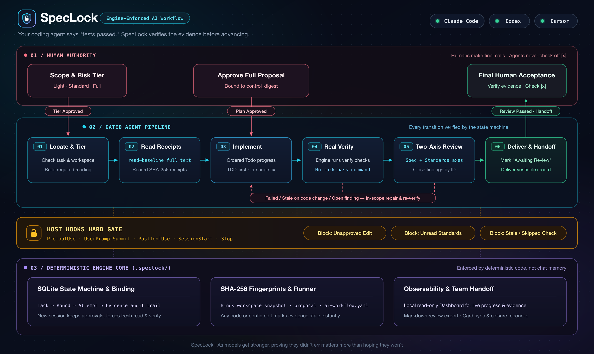

# SpecLock

**English** | [简体中文](README.zh-CN.md) · [Demo video](https://github.com/user-attachments/assets/6c399680-073c-4bd3-8bb2-d61fae7f9972) · [v0.29.0](docs/development/release-0.29.0.md)

**Your coding agent says the tests passed. SpecLock requires the results before it accepts a review.**

SpecLock is an AI development workflow plugin for **Codex, Claude Code, and Cursor**. It ties task cards, human approvals, implementation steps, and verification results together. Scope the process to the risk, require current evidence to move forward, and leave final acceptance to a person.

[Quick start](#quick-start-run-auth-r03) · [Workflow at a glance](#workflow-at-a-glance) · [What you get](#what-you-get-at-the-end-of-a-task) · [OpenSpec and Superpowers](#how-it-compares-to-openspec-and-superpowers)



## Quick start: run `AUTH-R03`

Try adding token expiry and revocation in an example project, without touching your own code.

1. Clone SpecLock and enter the example directory:

   ```bash
   git clone https://github.com/lvzhiyi/speclock.git
   cd speclock
   cd ./examples/speclock-codex-test
   ```

2. [Install `workflow-core` in Codex](#codex) and open the example directory in Codex. The example is already configured; skip `init`.
3. Start a new Codex session and trust and enable the SpecLock hooks in `/hooks` or **Settings → Hooks**. First, send:

   ```text
   $workflow-core:dashboard on
   ```

   Open the returned local URL in your browser and leave the dashboard open to follow the task from the start.

4. Return to the same Codex session and send:

   ```text
   $workflow-core:workflow Run AUTH-R03
   ```

5. Confirm the **Full** tier and approve the proposal after reviewing it. Once the required checks and review pass, the task card will say **Review Passed, Pending Human Acceptance**. It will not be checked off automatically.

## Workflow at a glance

| Stage | What happens |
| --- | --- |
| **1. Break down a PRD (optional)** | [`prd-breakdown`](plugins/workflow-core/skills/prd-breakdown/SKILL.md) turns a product requirements document into independently testable tasks, with source references, dependencies, and acceptance criteria in repository task cards. Have an existing task or a well-scoped small edit? Go straight to confirmation. |
| **2. Confirm and start** | The agent locates the task, checks the workspace, and builds the required-reading and verification lists. You confirm scope and tier, and separately review and approve the proposal for a Full task. The engine records receipts for required reading; missing or truncated reads block implementation. |
| **3. Implement by tier** | **Light:** make the smallest change that satisfies the todo. **Standard:** use a 3–5 step plan in the existing card or issue, and run failing cases and targeted regression tests along the way. **Full:** save the approved proposal and design as `proposal.md` and `design.md`, then work through the ordered todos. All tiers track step completion and prefer writing a failing test first; if that is not appropriate, record why and what will be checked instead. |
| **4. Verify** | Run the checks specified under `verify` in `ai-workflow.yaml`: documentation rules, formatting, static analysis, relevant tests, and any required builds or end-to-end tests. Record commands, exit codes, and the workspace snapshot. A missing, failed, or stale check blocks review. |
| **5. Review on two axes** | Review a fixed set of task changes without editing code. **Spec** checks for missing, extra, or incorrect behavior and gaps in acceptance coverage. **Standards** checks project conventions, terminology, and code quality. Every tier must pass both; after fixing and re-verifying, explicitly close each required finding by the same ID instead of dropping it from the report. |
| **6. Hand off for human acceptance** | When review passes, a linked task card is updated to “review passed, awaiting human acceptance.” The agent hands over the evidence and coverage gaps without checking off the card. |

**Open the Dashboard at any time.** Send `$workflow-core:dashboard on` separately in Codex, then open the local URL it returns. The read-only dashboard shows the tier, implementation todos, failures or open decisions, verification results, and review evidence. Confirmations and approvals still happen in the agent's chat.

## What you get at the end of a task

SpecLock does not leave you with just "done." You get a record you can check against the current code:

- **Verifiable evidence.** Who approved which version of the proposal, which standards were read, which checks actually ran and their exit codes, and how required review findings were closed are all stored per task round. Changes to relevant code or configuration invalidate the evidence automatically. Use the dashboard day to day; for details, ask the agent for `status` / `history`, or export a Markdown review with `render-md`.
- **A clear split between people and agents.** Only a person can confirm the tier, approve a proposal, or send a task back. The agent stops at "review passed, awaiting human acceptance"; you check off the card.
- **Handoffs that survive a new session.** A new session or agent resumes from the engine state, not from chat memory: approved proposals stay valid, but it must reread the standards and earn fresh verification results.

Evidence is stored locally in `.speclock/` and is not committed. For team review, rerun the same `verify` checks on the PR in CI. See [Verifiable evidence and handoffs](docs/evidence-and-handoff.md) (Chinese).

## How it compares to OpenSpec and Superpowers

**SpecLock can block a step, show where work stands, and back up the result with evidence.** [OpenSpec](https://github.com/Fission-AI/OpenSpec) organizes work around change specifications and makes post-implementation verification optional in its default workflow. [Superpowers](https://github.com/obra/superpowers) uses skills to require verification before the agent reports completion. SpecLock adds **gates enforced by a project-level engine**: the agent cannot advance the task just by saying it finished a step.

**Why it matters:** The agent cannot start without the required approvals and reading, send changes to review with skipped checks or stale results, or pass review with unresolved required findings. Teams can catch problems earlier, cut rework, and track progress without digging through chat. At handoff, they can see which checks ran on the current code, what the results were, and which findings were resolved.

- **Starting work requires clearance.** Every tier needs human confirmation of scope and tier. Full tasks also need separate approval of the current proposal. Missing, incomplete, or stale receipts for required reading block implementation.
- **See progress without following the chat.** The read-only Dashboard shows the current step, what's blocking it, who needs to act next, and the verification and review evidence for this run.
- **Results must match the current code.** The engine runs the required project checks, records their exit codes, and binds them to a workspace snapshot. Skipped or failed checks block review, as do results invalidated by changes to relevant code or configuration.
- **Removing a finding from the report does not fix it, and passing review is not acceptance.** Both review axes must pass. On retry, required findings must be explicitly closed under the same axis and ID. A linked task card moves to “review passed, awaiting human acceptance”; only a person checks it off.

**Host hooks, a SQLite state machine, and SHA-256 file fingerprints** back these gates. Hooks enforce them on covered tool paths; the engine stores approvals, read receipts, verification results, and review evidence per task round. See the [engine protocol and CLI](docs/development/workflow-engine.md#cli-示例).

## Installation

Use Python 3.9+ and Git. Start with `workflow-core`; extra plugins are optional.

### Codex

```bash
codex plugin marketplace add lvzhiyi/speclock --ref main
codex plugin add workflow-core@speclock
```

After installation or an update, trust and enable the plugin's hooks in `/hooks` or **Settings → Hooks** and start a new session. If confirmations are not recorded, check hook trust before retrying; see [tier selection and approval](plugins/workflow-core/skills/workflow/SKILL.md#在-agent-窗口定档).

### Claude Code

```bash
claude plugin marketplace add lvzhiyi/speclock
claude plugin install workflow-core@speclock
```

### Cursor

Add this repo as a marketplace and select `workflow-core`, or load `plugins/workflow-core` locally. See the [Cursor adapter guide](docs/development/cursor-adapter.md#安装与检查).

**Scope:** Hooks apply only to the tool paths the host actually routes through enabled callbacks. SpecLock is not a security sandbox. Integration tests do not replace a full test in a real client session.

## Use it in your project

1. Run `workflow-core:init` once per project (Codex: `$workflow-core:init`; Claude Code: `/workflow-core:init`). Review the proposed `ai-workflow.yaml`, required standards, and check commands.
2. Use `workflow-core:workflow` with a task ID or a short request. For a full PRD, use [`prd-breakdown`](plugins/workflow-core/skills/prd-breakdown/SKILL.md) first.
3. For an interrupted task, give the next session its task ID and [handoff notes](plugins/workflow-core/skills/handoff/SKILL.md), if available.

## More

- **Workflow reference:** [Workflow skill](plugins/workflow-core/skills/workflow/SKILL.md#任务路径) · [Handling failed checks](plugins/workflow-core/skills/verify/SKILL.md#失败处理顺序) · [Engine protocol and CLI](docs/development/workflow-engine.md#cli-示例)
- **Project tools:** [Read-only dashboard](plugins/workflow-core/skills/dashboard/SKILL.md) · [Local metrics](plugins/workflow-core/skills/metrics/SKILL.md) · [Standalone doc checker](plugins/workflow-core/scripts/vendor_check_docs.py)
- **Optional plugins:** [`stack-flutter`](plugins/stack-flutter), [`design-pixso`](plugins/design-pixso), and [`api-apifox`](plugins/api-apifox). Claude Code can install the [combined preset](README.zh-CN.md#可选插件).
- **Project links:** [Issues](https://github.com/lvzhiyi/speclock/issues) · [Release notes](docs/development/release-0.29.0.md) · [MIT License](LICENSE)
