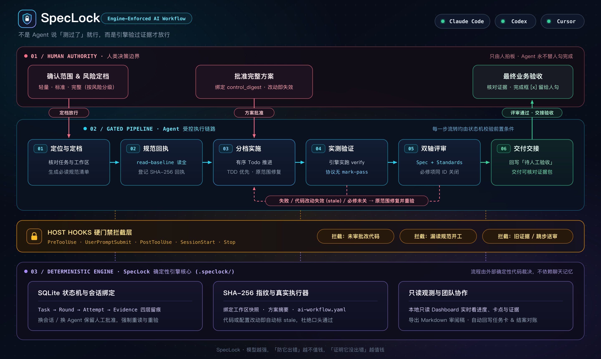

# SpecLock

[English](README.md) | **简体中文** · [演示视频](https://github.com/user-attachments/assets/6c399680-073c-4bd3-8bb2-d61fae7f9972) · [v0.29.0](docs/development/release-0.29.0.md)

**AI 说「测试过了」还不够。SpecLock 要看到验证结果，才允许评审。**

SpecLock 是面向 **Codex、Claude Code 和 Cursor** 的 AI 开发工作流插件。它把任务卡、人工授权、实施步骤和验证结果连到同一条流程：按风险决定怎么做，有当前证据才能进入下一阶段，最后由人验收。

[快速上手](#快速上手执行-auth-r03) · [工作流一览](#工作流一览) · [任务结束时你拿到什么](#任务结束时你拿到什么) · [与 OpenSpec 和 Superpowers 的区别](#与-openspec-和-superpowers-的区别)



## 快速上手：执行 `AUTH-R03`

在示例项目里为 API Token 加上过期和吊销校验，不动你自己的项目。

1. 克隆 SpecLock，进入示例目录：

   ```bash
   git clone https://github.com/lvzhiyi/speclock.git
   cd speclock
   cd ./examples/speclock-codex-test
   ```

2. [给 Codex 安装 `workflow-core`](#codex)，在 Codex 中打开示例目录。示例已有配置，不用运行 `init`。
3. 新开 Codex 会话，在 `/hooks` 或 **Settings → Hooks** 信任并启用 SpecLock 钩子。先在聊天里发送：

   ```text
   $workflow-core:dashboard on
   ```

   在浏览器中打开返回的本机链接，保持看板开着，就能从开工起看到任务进度。

4. 回到同一个 Codex 会话，发送：

   ```text
   $workflow-core:workflow 开始执行任务 AUTH-R03
   ```

5. 按提示选**完整档**，看过方案后再批准。规定检查和评审通过后，任务卡会变成 **「评审通过，待人工验收」**，不会自动勾完成。

## 工作流一览

| 阶段 | 做了什么 |
| --- | --- |
| **1. PRD 拆解（按需）** | [`prd-breakdown`](plugins/workflow-core/skills/prd-breakdown/SKILL.md) 把需求文档拆成可独立验收的子任务，记到仓库任务卡，保留需求来源、依赖和验收条件。已有任务号或明确的小改动，可以直接进入开工确认，不必先写 PRD。 |
| **2. 确认后开工** | Agent 定位任务、检查当前工作区，生成必读基线与检查清单。你确认范围和档位；完整档还要单独审阅并批准方案。适用规范必须读全并登记回执，缺读或截断不能开工。 |
| **3. 分档实施** | **轻量**按待办做最小改动；**标准**在任务卡或 Issue 写 3～5 步短计划，中途跑失败用例与定向回归；**完整**将已批准的提案和设计写入 `proposal.md`、`design.md`，再按待办顺序实施。三档都记录步骤进度，优先先写失败测试；不采用时记录原因和替代验证。 |
| **4. 验证** | 按 `ai-workflow.yaml` 的 `verify` 配置实际运行规定检查：文档规范、代码格式、静态分析、相关测试，以及配置要求的构建或端到端测试。留存命令、退出码和工作区快照；检查没跑、失败或证据失效，都不能进评审。 |
| **5. 双轴评审** | 对固定的本任务改动只读评审：**Spec** 查漏做、多做、做偏和缺失的验收场景；**Standards** 查项目规范、术语和代码质量。三档都要两轴通过；必修项不能从重试报告里删掉，修复并复验后要用同一编号显式关闭。 |
| **6. 人工验收** | 评审通过后，已绑定的任务卡自动更新为「评审通过，待人工验收」。Agent 交接验证与评审证据、说明未覆盖项，不替你勾完成。 |

**随时查看 Dashboard。** 在 Codex 里单独发送 `$workflow-core:dashboard on`，手动打开返回的本机链接。只读看板展示当前档位、实施待办、失败或待确认项、验证结果与双轴评审证据。它不控制流程；定档和批准仍在 Agent 窗口完成。

## 任务结束时你拿到什么

SpecLock 交给你的不是一句「做完了」，而是一份能对照当前代码核对的记录：

- **可核对的凭证。** 谁批准了哪一版方案、读了哪些规范、实际跑了哪些检查和退出码、两轴评审的必修项如何关闭，都按任务轮次留在引擎里；相关代码或配置一变，证据自动失效。平时看看板即可，需要细节时让 Agent 查询 `status` / `history`，或用 `render-md` 导出 Markdown 审阅稿。
- **清楚的人机分工。** 定档、批准方案、退回只能由人确认；Agent 最多走到「评审通过，待人工验收」，完成框留给你勾。
- **能接力的交接。** 换会话或换 Agent 时，新执行者以引擎状态为准继续：已批准的方案仍然有效，但必须重读规范、重新取得验证结果，不靠上一段聊天记忆。

证据默认只保存在本机 `.speclock/`（不入 Git）。团队评审时，建议在 CI 中对 PR 重跑同一套 `verify` 检查。详见[可核对凭证与人机交接](docs/evidence-and-handoff.md)。

## 与 OpenSpec 和 Superpowers 的区别

**SpecLock 的区别是：过程能拦、进度能看、结果能核对。** [OpenSpec](https://github.com/Fission-AI/OpenSpec) 的默认流程围绕变更规格组织工作，实施后的核对是可选环节；[Superpowers](https://github.com/obra/superpowers) 通过技能要求 Agent 先验证再报完成。SpecLock 增加的是**由项目引擎执行的放行条件**：不是 Agent 说走到哪一步，就算走到了哪一步。

**这能减少什么？** 缺审批或漏读规范时，不让 Agent 抢跑；漏跑检查、拿旧结果送审，或必修问题没解决，也不能蒙混过关。团队可以更早发现问题、减少返工，不用翻聊天记录追进度；验收时能直接核对这版代码跑了哪些检查、结果如何、哪些问题已经解决。

- **开工有门槛。** 三档都要人工确认范围和档位；完整档还要单独批准当前版本的方案。必读规范缺回执、读不完整或内容已变，不能开始实施。
- **过程不用盯聊天。** 打开只读 Dashboard，就能看见当前做到哪一步、为什么卡住、下一步等谁，以及本轮验证和评审留下了什么证据。
- **结果必须对得上当前代码。** 引擎按项目配置实际运行规定检查，记录退出码并绑定工作区快照。没跑、跑失败，或相关代码和配置变化导致证据失效，都不能通过评审门禁。
- **删报告不等于修好，评审通过不等于验收。** 两个评审轴都要通过；必修项在重审时必须在原评审轴用同一编号明确关闭。已绑定的任务卡只回写「评审通过，待人工验收」，完成框留给人。

这些条件由**宿主钩子、SQLite 状态机和 SHA-256 文件指纹**支撑：钩子在已接入的操作路径执行门禁，引擎按任务轮次保存审批、回执、验证与评审证据。详见[引擎协议与 CLI](docs/development/workflow-engine.md#cli-示例)。

## 安装

需要 Python 3.9+ 和 Git。先装 `workflow-core`，其他插件按需添加。

### Codex

```bash
codex plugin marketplace add lvzhiyi/speclock --ref main
codex plugin add workflow-core@speclock
```

安装或升级后，到 `/hooks` 或 **Settings → Hooks** 信任并启用插件钩子，再新开会话。若定档或批准没有记录，先检查钩子是否受信任，不必反复发送确认口令。详见[定档与方案批准](plugins/workflow-core/skills/workflow/SKILL.md#在-agent-窗口定档)。

### Claude Code

```bash
claude plugin marketplace add lvzhiyi/speclock
claude plugin install workflow-core@speclock
```

### Cursor

从本仓库添加 marketplace 并选择 `workflow-core`，或本地加载 `plugins/workflow-core`。详见 [Cursor 适配说明](docs/development/cursor-adapter.md#安装与检查)。

**门禁边界：**只覆盖宿主实际调用了已启用钩子的工具路径，不是安全沙箱。引擎集成测试不等于真实客户端端到端验收。

## 在自己的项目中使用

1. 每个项目先跑一次 `workflow-core:init`（Codex：`$workflow-core:init`；Claude Code：`/workflow-core:init`），核对生成的配置、必读规范和检查命令。
2. 用 `workflow-core:workflow` 给出任务号或描述需求。有完整 PRD，再先用 [`prd-breakdown`](plugins/workflow-core/skills/prd-breakdown/SKILL.md) 拆成任务卡。
3. 换会话时发任务号，有[交接记录](plugins/workflow-core/skills/handoff/SKILL.md)就一并给出。

## 可选插件

- **Flutter / Pixso / Apifox**：按需添加 [`stack-flutter`](plugins/stack-flutter)、[`design-pixso`](plugins/design-pixso)、[`api-apifox`](plugins/api-apifox)。Apifox 需单独[安装 CLI 并登录](https://apifox.com/apifox-cli-installation-guide.md)；Pixso 首次使用时按提示授权。
- **Claude Code 组合包**：先运行 `claude plugin marketplace add flutter/agent-plugins`，再运行 `claude plugin install preset-flutter-pixso-apifox@speclock`。

## 深入了解

- **流程与恢复：**[工作流技能](plugins/workflow-core/skills/workflow/SKILL.md#任务路径) · [验证失败怎么处理](plugins/workflow-core/skills/verify/SKILL.md#失败处理顺序) · [引擎协议与 CLI](docs/development/workflow-engine.md#cli-示例)
- **项目工具：**[看板](plugins/workflow-core/skills/dashboard/SKILL.md) · [流程度量](plugins/workflow-core/skills/metrics/SKILL.md) · [独立文档检查脚本](plugins/workflow-core/scripts/vendor_check_docs.py)
- **参与项目：**[Issues](https://github.com/lvzhiyi/speclock/issues) · [版本说明](docs/development/release-0.29.0.md) · [MIT 许可证](LICENSE)
